<p align="center">
  
</p>

<h1 align="center">QuestFlow</h1>
<p align="center">
  <strong>Finish the work. Level up the team.</strong>
</p>

<p align="center">
  <a href="https://github.com/Shimrah07/QuestFlow"></a>
  <a href="https://github.com/Shimrah07/QuestFlow"></a>
  <a href="https://github.com/Shimrah07/QuestFlow"></a>
  <a href="https://github.com/Shimrah07/QuestFlow"></a>
  <a href="https://github.com/Shimrah07/QuestFlow"></a>
  <a href="https://github.com/Shimrah07/QuestFlow"></a>
  <a href="https://github.com/Shimrah07/QuestFlow"></a>
</p>

QuestFlow is a full-stack team workspace for tasks, expense claims and approvals, with game mechanics on top. Finished tasks earn XP, XP builds levels, weekly and team quests pay bonuses, and the team competes on a leaderboard. Four smart features run entirely in the browser with no paid AI service: a receipt scanner that fills in expense claims from a photo, risk flags that point reviewers at suspicious claims, a task assistant that suggests XP and assignees, and dashboard insights.

<p align="center">
  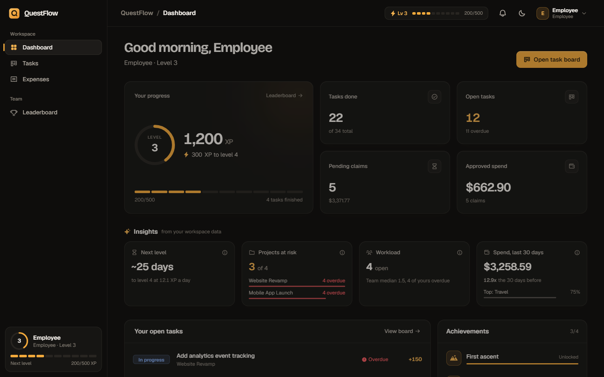
</p>

---

## Highlights

**Work and progress**
- Drag-and-drop task board (To do, In progress, Done) with XP rewards, due dates and overdue flags. It works with a mouse, touch or the keyboard, and follows the same permissions as the buttons.
- Every 500 XP is a new level, marked by a celebration with confetti and any newly unlocked achievements. There's also a team leaderboard with a top-three podium.
- Quests on top of tasks. Everyone gets three weekly quests (finish 3 tasks, beat a deadline, earn 500 XP) with bonus XP, and managers can set team quests on a project ("finish 6 Website Revamp tasks by Friday") whose bonus pool is split by contribution. Bonuses arrive live and can trigger a level-up.
- Expense claims with manager approval. Nobody can approve their own claim.
- Live notifications created by the server and pushed to the browser within seconds: new tasks for you, claims approved or rejected, deadlines coming up, level-ups, and for managers new claims to review and teammates finishing work. Each one links to the right page, nobody is told about their own actions, and read state follows you across devices.
- Three roles (Admin, Manager, Employee), enforced by the API and mirrored in the interface.

**Smart features, all in the browser**
- **Receipt scanner.** Snap or upload a receipt and PaddleOCR (PP-OCRv4, the model family behind RapidOCR) reads it on the device through ONNX Runtime Web. It extracts the merchant, total, date, currency and category, shows its confidence for each, and highlights where it found them on the photo. Tilted photos are de-skewed automatically. The image never leaves the device.
- **Expense risk flags.** The Approvals queue scores each pending claim for duplicates, amounts that are unusual for the category or the person, large or round figures, and bursts of claims. Every flag explains itself ("Same title and amount as EXP-72, submitted 1 day apart"), and the queue can be sorted by risk.
- **Task assistant.** While a manager types a new task, it suggests an XP reward from the most similar past tasks (text similarity over the team's history) and ranks who should take it by related finished work, project familiarity and current workload. Every suggestion shows its evidence, and nothing changes until it's clicked.
- **Dashboard insights.** A forecast of the next level, projects at risk from overdue work, workload balance across the team, and spending over the last 30 days compared with the 30 before.

**Engineering**
- JWT access tokens with rotating, revocable refresh tokens and an automatic client-side refresh queue.
- A custom design system: one accent colour, light and dark themes, responsive down to 360px, reduced-motion support, and accessible dialogs with focus trapping.
- Three test layers: pytest for the API, Vitest for the browser logic, and Playwright end to end, including a real OCR scan.

---

## Screenshots

| | |
| :--- | :--- |
| **Sign in**<br/>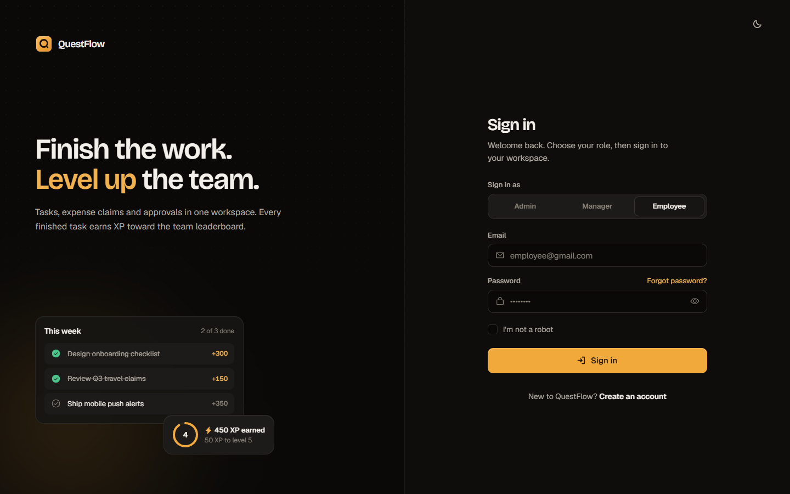 | **Task board**<br/>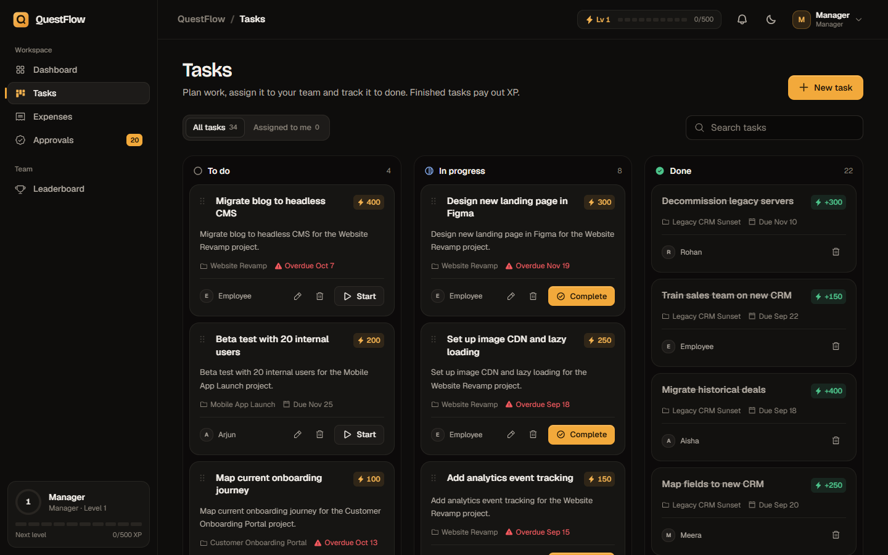 |
| **Receipt scanner**<br/>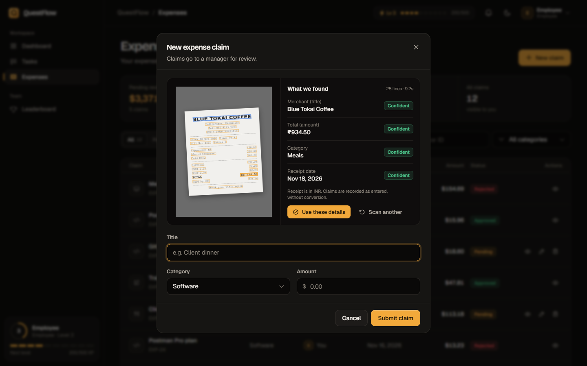 | **Risk flags in Approvals**<br/>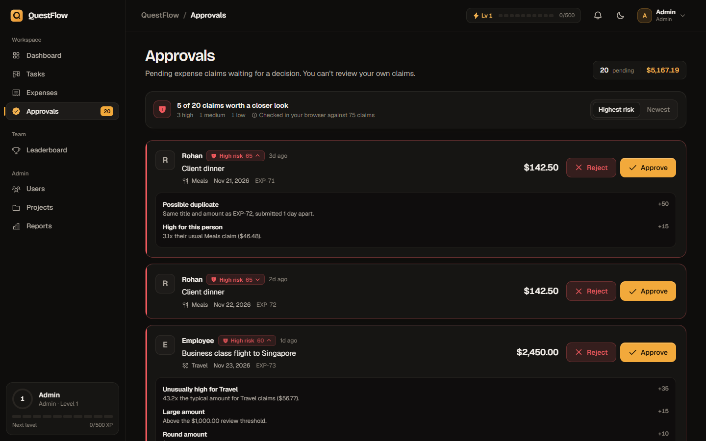 |
| **Task assistant**<br/>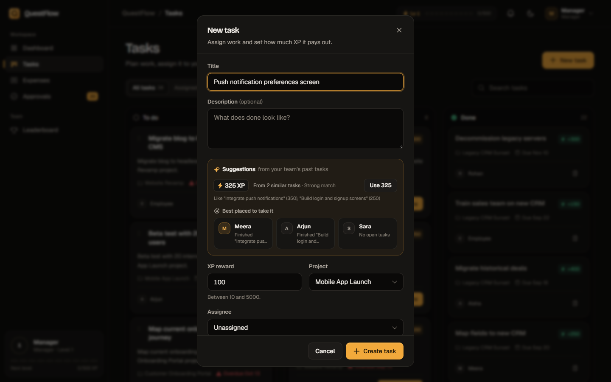 | **Level-up celebration**<br/>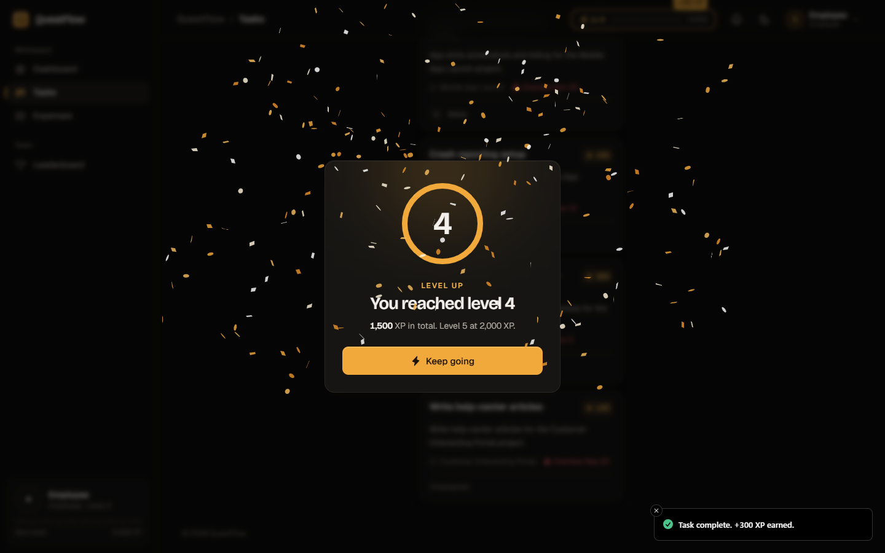 |
| **Expense claims**<br/>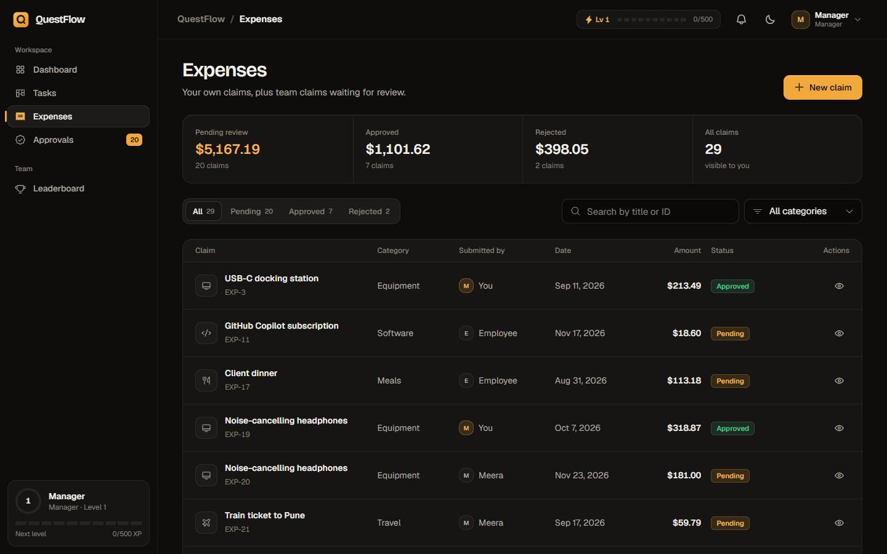 | **Leaderboard**<br/>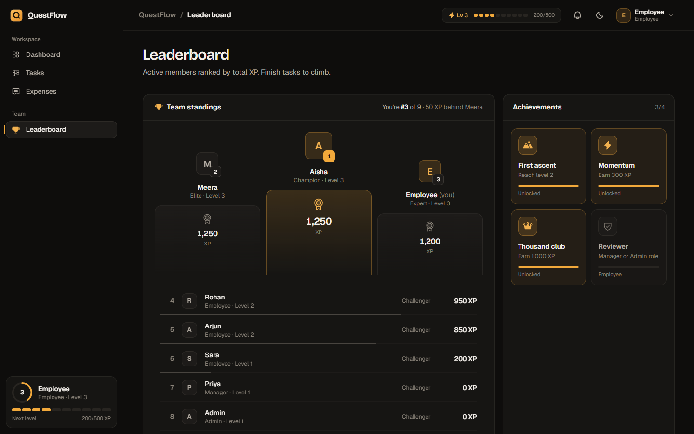 |
| **Quests**<br/>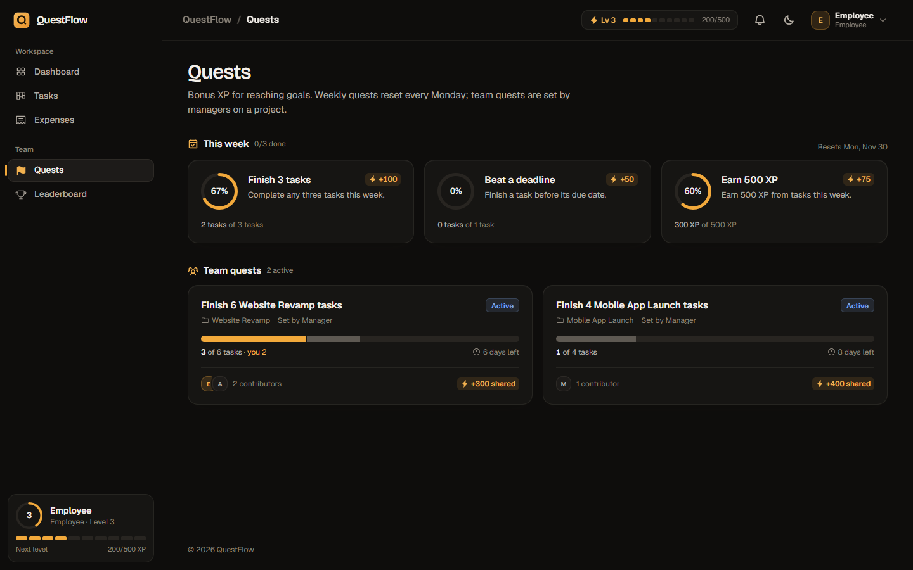 | **Team reports**<br/>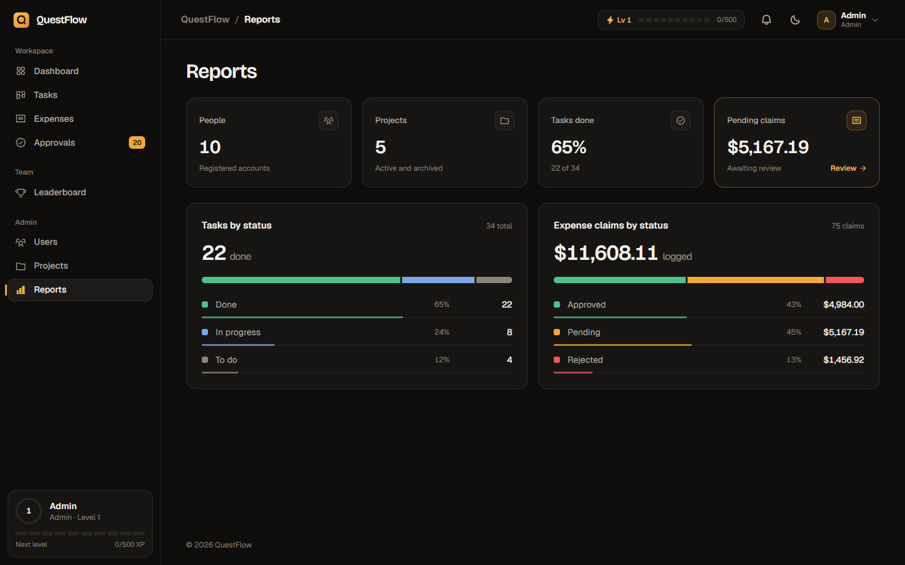 |
| **Light theme**<br/>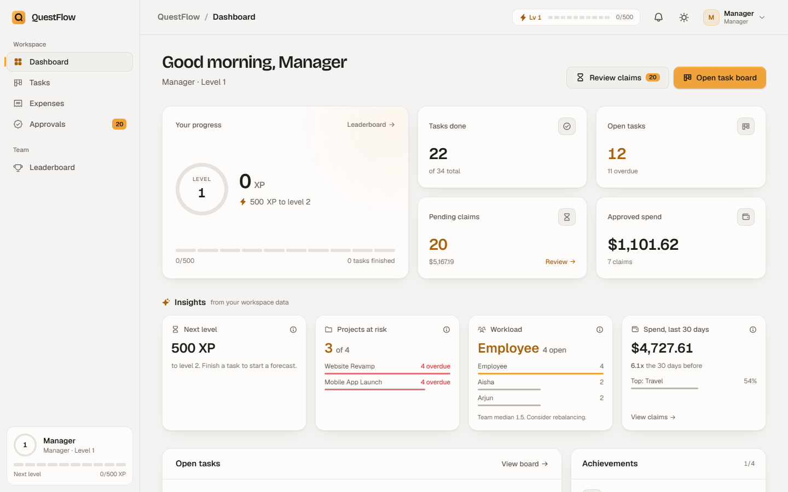 | |

---

## Tech stack

| Layer | Technology |
| :--- | :--- |
| Frontend | React 19, Vite 8, React Router 7, Tailwind CSS v4, Framer Motion, dnd-kit, canvas-confetti, Phosphor icons, Sonner, Recharts |
| Typography | Bricolage Grotesque (display), Geist (interface), Geist Mono (codes) |
| In-browser intelligence | PaddleOCR PP-OCRv4 on ONNX Runtime Web with OpenCV.js (receipt scanner); plain JavaScript for the rest: a rules-and-statistics risk engine, TF-IDF similarity for the task assistant, and the insights calculations |
| Backend | Python, FastAPI, SQLAlchemy 2.0, Pydantic v2, python-jose (JWT), bcrypt |
| Database | PostgreSQL (Neon in production); local PostgreSQL or SQL Server for development |
| Testing | pytest, Vitest, Playwright |

---

## Architecture

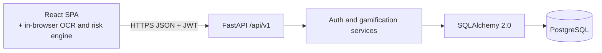

The full write-up covers the data model, authentication flow, role matrix, design system, how the scanner and risk engine work, testing and deployment: [docs/architecture.md](./docs/architecture.md).

```text
QuestFlow/
├── backend/    FastAPI app (core, db, models, routes, schemas, services), scripts, pytest suite
├── frontend/   React app (components, context, layouts, lib, pages, routes, services), Playwright specs
└── docs/       architecture.md and screenshots
```

---

## Demo accounts

| Role | Email | Password | Can |
| :--- | :--- | :--- | :--- |
| Admin | `admin@gmail.com` | `Admin@123` | Everything, including users, projects and reports |
| Manager | `manager@gmail.com` | `Manager@123` | Create and assign tasks, review claims |
| Employee | `employee@gmail.com` | `Employee@123` | Work on assigned tasks, submit claims |

Seven more demo teammates (Priya, Rohan, Aisha, Arjun, Sara, Meera, Kabir) sign in as `<name>@gmail.com` with `Demo@1234`. Admin accounts can't be self-registered.

**Demo data.** `python scripts/seed_demo_data.py` (from `backend/`) fills an empty database with these accounts, five projects and about three months of tasks, expense claims and quests. It only seeds a database with no projects, so it's safe to run on every start, and it never changes existing accounts. `--reset` wipes and reseeds, and works only on a local database. These passwords are public, so treat the live demo as a demo.

---

## Getting started

### 1. Backend

Create `backend/.env`:

```env
DATABASE_URL="postgresql://postgres:<password>@localhost:5432/questflow"
JWT_SECRET_KEY="<long random string>"
JWT_REFRESH_SECRET_KEY="<another long random string>"
ACCESS_TOKEN_EXPIRE_MINUTES=15
REFRESH_TOKEN_EXPIRE_DAYS=7
```

SQL Server works too: `mssql+pyodbc://localhost/TaskExpenseDB?driver=ODBC+Driver+17+for+SQL+Server&trusted_connection=yes`.

```powershell
cd backend
python -m venv venv
.\venv\Scripts\Activate.ps1
pip install -r requirements.txt
python scripts/seed_demo_data.py
python -m uvicorn app.main:app --host 127.0.0.1 --port 8000 --reload
```

Tables are created automatically on startup. API documentation is at http://127.0.0.1:8000/docs.

### 2. Frontend

Create `frontend/.env.local` so the app talks to your local API (without it, the app uses the deployed API):

```env
VITE_API_URL=http://127.0.0.1:8000/api/v1
```

```powershell
cd frontend
npm install
npm run dev
```

Open http://localhost:5173.

---

## Testing

```powershell
# API (pytest, in-memory SQLite)
cd backend
.\venv\Scripts\pytest -v

# Browser logic: receipt parser, risk engine, task assistant, insights (Vitest)
cd frontend
npm test

# End to end (Playwright). Start the backend on :8000 and the frontend on :5173 first.
npx playwright install chromium   # first time only
npm run test:e2e

# Production build
npm run build
```

---

## Deployment

- **Frontend:** Vercel or Netlify. Set `VITE_API_URL` to the deployed API. The OCR models are emitted as hashed static files and load only when someone opens the scanner.
- **Backend:** Render web service (root directory `backend`), with `DATABASE_URL`, `JWT_SECRET_KEY` and `JWT_REFRESH_SECRET_KEY` set. Start command, which seeds the demo data the first time and then just starts the API:
  ```
  python scripts/seed_demo_data.py --allow-remote; uvicorn app.main:app --host 0.0.0.0 --port $PORT
  ```
- **Database:** Neon serverless PostgreSQL.

---

## About

QuestFlow was built as a portfolio and major project to show secure full-stack engineering, a considered interface, and practical machine intelligence that runs on the user's device. Known limitations and future work are listed at the end of [docs/architecture.md](./docs/architecture.md#9-known-limitations).

## License

Released under the MIT License.
