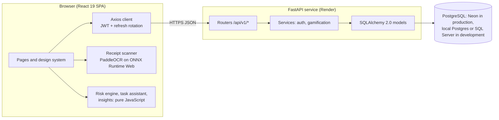
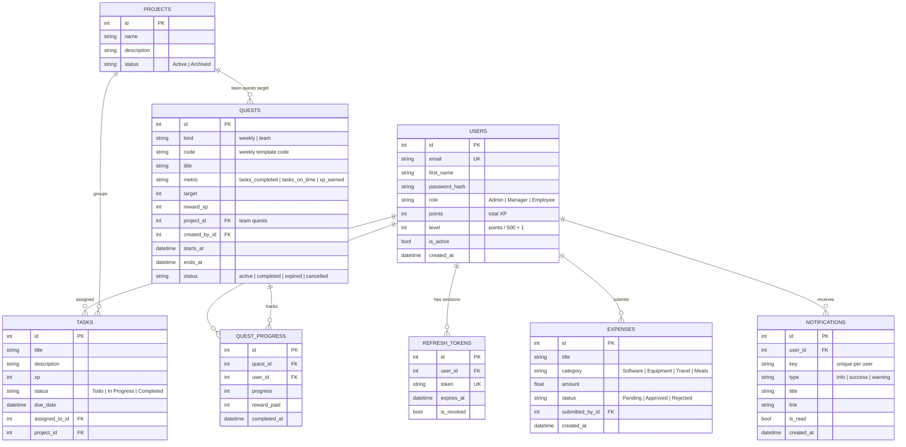
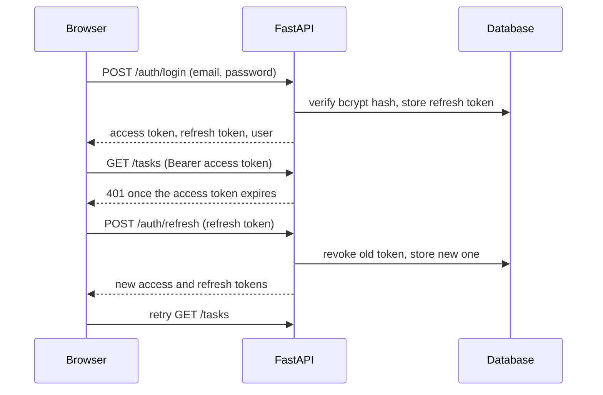
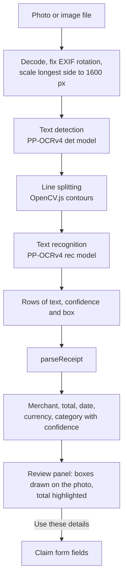

# QuestFlow architecture

This document explains how QuestFlow is put together: the backend API, the data model, authentication and roles, the React frontend and its design system, and the four features that run entirely in the browser (the receipt scanner, expense risk flags, the task assistant and dashboard insights). It ends with how the project is tested and deployed, and its known limitations.

## 1. What the system does

QuestFlow is a team workspace for three jobs:

1. **Tasks.** Managers create tasks, set an XP reward and assign them. Finishing a task awards its XP to the assignee.
2. **Expense claims.** Anyone submits claims; managers and admins approve or reject them. Nobody can approve their own claim.
3. **Progress.** XP drives levels (every 500 XP), achievements and a team leaderboard. Tasks move across a drag-and-drop board, and reaching a new level triggers a celebration. Weekly quests and manager-set team quests pay bonus XP on top of task rewards.

Four features add intelligence without a server or a paid API:

- **Receipt scanner.** Reads a receipt photo on the device and fills in the claim form.
- **Expense risk flags.** Scores pending claims for duplicates and unusual amounts and explains each flag.
- **Task assistant.** Suggests an XP reward and the best-placed assignees for a new task from the team's history.
- **Dashboard insights.** Forecasts the next level, and surfaces projects at risk, uneven workload and spending trends.

## 2. System overview



None of the in-browser features call the backend. The scanner and the task assistant only fill in the normal forms, which then submit as usual. The risk engine and insights read data the page has already loaded.

## 3. Repository layout

```text
QuestFlow/
├── backend/
│   ├── app/
│   │   ├── core/        config (env-driven settings), security (bcrypt, JWT), deps (DB session, auth, RBAC)
│   │   ├── db/          SQLAlchemy engine and declarative base
│   │   ├── models/      User, RefreshToken, Project, Task, Expense, Notification, Quest, QuestProgress
│   │   ├── routes/      auth, users, projects, tasks, expenses, reports, notifications, quests
│   │   ├── schemas/     Pydantic v2 request and response models
│   │   ├── services/    AuthService, GamificationService, NotificationService, QuestService
│   │   └── main.py      app factory, CORS, router registration, table creation
│   ├── scripts/         seed_demo_data.py (demo team and history), seed_e2e_users.py (test accounts)
│   └── tests/           pytest suite (in-memory SQLite)
├── frontend/
│   ├── e2e/             Playwright specs
│   ├── public/          logo and favicon
│   └── src/
│       ├── components/  common (shell, ErrorBoundary), ui (design-system primitives), expenses (ReceiptScanner),
│       │                tasks (TaskAssistantPanel), dashboard (InsightsPanel, QuestsCard), gamification (LevelUpCelebration)
│       ├── context/     Auth, Theme, Toast, Notification providers
│       ├── layouts/     AuthLayout, DashboardLayout
│       ├── lib/         ocr/ (engine + parser), expenseRisk.js, taskAssistant.js, insights.js, each with unit tests
│       ├── pages/       auth, dashboard, tasks, expenses, approvals, quests, gamification, admin
│       ├── routes/      route table and ProtectedRoute guard
│       └── services/    api.js (Axios), auth.js
└── docs/                this document and screenshots
```

## 4. Backend

### 4.1 Layers

| Layer | Responsibility |
| --- | --- |
| `routes/` | HTTP endpoints. Each declares its role requirement with `Depends(check_role([...]))` and does request-level checks (ownership, status rules). |
| `services/` | Business logic shared across routes: account creation, login, token rotation, password reset, XP awards. |
| `models/` | SQLAlchemy 2.0 typed models. Tables are created on startup with `Base.metadata.create_all`. |
| `schemas/` | Pydantic v2 models that validate input (Gmail-only emails, password strength, XP 10 to 5000) and shape output. |
| `core/` | Settings from environment variables (the JWT secrets are required, so the app refuses to start without them), password hashing and token helpers, dependency providers. |

### 4.2 Data model



Projects are archived (soft-deleted) rather than removed, so their task history survives.

### 4.3 Authentication

QuestFlow uses a short-lived access token (15 minutes) and a long-lived refresh token (7 days), each signed with its own secret. Every refresh token is stored in the database so it can be revoked, and each refresh rotates it: the old token is revoked and a new pair is issued.



On the client, the Axios response interceptor handles this transparently. If several requests fail at once, they queue behind a single refresh call. If the refresh itself fails, the session is cleared and the user returns to the sign-in page.

### 4.4 Roles and permissions

| Capability | Employee | Manager | Admin |
| --- | --- | --- | --- |
| View tasks | Only tasks assigned to them | All | All |
| Create, edit or delete tasks | No | Yes | Yes |
| Change a task's status | Own assigned tasks (status only; XP, assignee and other fields are refused) | Any | Any |
| Reopen a completed task | No | No | No (completed tasks are locked) |
| Projects | No access | List, create, edit | Also archive |
| View expense claims | Own | Own plus all pending | All |
| Edit or delete a claim | Own, while pending | Own, while pending | Any |
| Approve or reject claims | No | Yes, never their own | Yes, never their own |
| Users, roles, reports | No | List users | Full access |

The backend enforces every rule. The frontend mirrors them (hidden navigation, `ProtectedRoute`, disabled buttons) only for a clearer experience.

### 4.5 XP and levels

`GamificationService.award_xp` adds a task's XP to its assignee when the task moves to `Completed`, then sets `level = points // 500 + 1`.

Two server-side rules keep XP honest:

- **Employees can only change a task's status.** A request from an employee that also changes the XP, assignee, project, title, description or due date is refused with 403, so nobody can raise their own reward and complete in one step.
- **Completed tasks are locked.** Moving a completed task back to another status is refused with 400 for every role, so a task can never pay out twice. Completing an already completed task is a no-op. The frontend shows progress within the current level (a ring and a ten-cell meter, each cell worth 50 XP) and derives achievements from level, XP and role.

### 4.6 API summary

All routes live under `/api/v1`. Interactive documentation is served at `/docs`.

| Area | Endpoints |
| --- | --- |
| Auth | `POST /auth/register`, `/login`, `/refresh`, `/logout`, `/forgot-password`, `/verify-otp`, `/reset-password` |
| Users | `GET /users/`, `/users/me`, `/users/leaderboard`; `PUT /users/{id}/status`, `/users/{id}/role` |
| Projects | `GET /projects/`, `/projects/{id}`; `POST /projects/`; `PUT /projects/{id}`; `DELETE /projects/{id}` (archives) |
| Tasks | `GET /tasks/` (search and filters; employees receive only their own tasks), `/tasks/{id}` (403 for an employee opening someone else's task); `POST /tasks/`; `PUT /tasks/{id}`, `/tasks/{id}/status`; `DELETE /tasks/{id}` |
| Expenses | `GET /expenses/` (filtered by role), `/expenses/{id}`; `POST /expenses/`; `PUT /expenses/{id}`, `/expenses/{id}/status`; `DELETE /expenses/{id}` |
| Reports | `GET /reports/summary` (Admin) |
| Notifications | `GET /notifications/` (own list, newest first), `/notifications/unread-count`, `/notifications/stream` (server-sent events); `PUT /notifications/{id}/read`, `/notifications/read-all`; `DELETE /notifications/` |
| Quests | `GET /quests/` (this week's quests with the caller's progress, plus active and recent team quests); `POST /quests/team` (Manager, Admin); `DELETE /quests/{id}` (cancels; creator or Admin) |

## 5. Frontend

### 5.1 Stack

React 19 with Vite 8, React Router 7, Tailwind CSS v4, Framer Motion, Phosphor icons, Sonner toasts and Recharts. Pages are lazy-loaded per route.

### 5.2 Structure

- **Providers** (outermost first): `ThemeProvider`, `ToastProvider`, `AuthProvider`, `NotificationProvider`.
- **Routing:** `/login`, `/register` and `/forgot-password` use `AuthLayout`. Everything else sits inside `ProtectedRoute` and `DashboardLayout` (sidebar, top bar, mobile drawer). Role-restricted routes wrap their page in a second `ProtectedRoute` with `allowedRoles`.
- **Navigation:** one config (`components/common/navigation.js`) defines every nav item, its allowed roles and its page title.
- **Session:** tokens and the cached user live in `localStorage`. The Approvals badge in the sidebar refreshes every 10 seconds and whenever a page fires an `approvals-updated` event.
- **Resilience:** an error boundary wraps each page, so a crash in one page shows a recoverable message while navigation keeps working. It resets on navigation.

### 5.3 Task board

The Tasks page is a three-column board (To do, In progress, Done) built with `@dnd-kit/core`.

- **Input:** cards can be dragged with a mouse or touch (from anywhere on the card, after a few pixels of movement so clicks still work) or with the keyboard (Space on the grip, Left or Right to jump a column, Space to drop). Enter on a card's buttons never starts a drag.
- **Rules:** Done cards are locked for everyone. Employees can only take the next step on their own tasks (To do to In progress, then In progress to Done), exactly as the Start and Complete buttons allow. Managers and admins can move open tasks between any columns, as their edit dialog already permits. While a card is in the air, columns it can't go to are dimmed.
- **Server path:** a drop calls the same status handler as the buttons, so XP awards, toasts and level-ups behave identically. The card moves immediately and returns to its column if the server refuses.
- **Screen readers:** drag start, hover and drop are announced in plain language.

### 5.4 Level-up celebration

`LevelUpCelebration` lives in the dashboard layout and watches the signed-in user's level. When the level rises during the session, whatever caused it, it shows the new level with a filling ring, confetti in the accent palette and any achievements unlocked by the jump. It never fires on sign-in or page load. It closes on click, Escape or after about five seconds, and drops the confetti under reduced motion. The top bar's XP meter also shows a short "+N XP" pop whenever points go up.

### 5.5 Notifications

Notifications are created by the backend when things happen and pushed to the browser as they arrive.

**Events (`services/notification_service.py`).** The person who caused an event is never notified about it.

| Event | Who is notified |
| --- | --- |
| Task created for someone, or reassigned | The new assignee |
| Task completed | Managers and admins. The assignee too, when someone else marked it done |
| Claim submitted | Every active manager and admin except the submitter |
| Claim approved or rejected | The submitter. Other reviewers' unread "to review" notes for that claim are removed |
| Level up | The user |
| Task due within 24 hours, or overdue in the last three days | The assignee (generated when they load notifications, so no scheduler is needed) |
| New account | A welcome note |

Each notification has a `key` naming its event, and `(user_id, key)` is unique, so an event is never stored twice. Deleting a task or claim removes its notifications.

**Delivery.** `GET /notifications/stream` is a server-sent-events stream. It checks for the user's new rows every three seconds (one indexed query) and sends each as an event, with a keep-alive ping in between. The stream ends itself after four minutes and the browser reconnects with a fresh access token, which also stops open streams from holding up a deploy or reload. The browser reads the stream with `fetch` so the token travels in a header rather than the URL, reconnects with backoff after errors, and opens it about two seconds after the page loads so the page's own data comes first. Nothing is missed in between, because each connection asks only for notifications newer than the last one it has.

**In the browser.** `NotificationContext` loads the list on sign-in, adds pushed notifications as they arrive, re-syncs when the tab regains focus (so read state matches across devices), and saves read, read-all and clear to the server. The bell shows an unread count, relative times, and opens the linked page on click.

### 5.6 Quests

Quests give people a reason to come back each week and give managers a way to rally a team behind a project. All quest logic runs on the server (`services/quest_service.py`) and is driven by task completion, so there is no scheduler.

**Weekly quests.** Everyone gets the same three personal quests each week (Monday to Sunday). They are created lazily the first time anyone loads quests or completes a task that week.

| Quest | Counts | Target | Bonus |
| --- | --- | --- | --- |
| Finish 3 tasks | Any completed task | 3 | +100 XP |
| Beat a deadline | A task finished before its due date | 1 | +50 XP |
| Earn 500 XP | Task XP earned this week (quest bonuses don't count, so bonuses can't feed each other) | 500 | +75 XP |

**Team quests.** A manager or admin picks an active project, a number of tasks (1 to 50), a bonus pool (25 to 5000 XP) and an end date (at most 90 days ahead). The people with tasks in that project are notified. Every task completed in the project before the end date counts. When the target is reached, the pool is split by contribution using the largest-remainder method, so the shares always add up exactly to the pool (300 XP over 2 and 1 tasks pays 200 and 100). The creator or an admin can cancel an active quest. Quests past their end date become expired when the board is next loaded.

**Integrity.** Progress is stored per person in `QUEST_PROGRESS`, and each row records what it paid, so a quest pays out once. Because completed tasks are locked (section 4.5), a task can't be completed twice to farm progress. Bonuses go through `GamificationService.award_xp`, so they can trigger a level-up like any other XP.

**In the browser.** The Quests page shows the weekly quests with progress bars, then the team quests with a bar segmented by contributor, each person's share and time left; finished and expired ones move to a collapsed "Recent" list. The dashboard has a compact quests card. Quest notifications arrive over the notification stream. A completed quest shows a toast and refreshes the user's XP straight away, so the XP meter and level-up celebration react without a reload, and any open Quests page reloads itself.

### 5.7 Design system

| Element | Choice |
| --- | --- |
| Colour | One warm-graphite neutral family and one accent, "quest gold" (`--accent`). Green, red and blue are used only for status. Every colour is a CSS variable with a light and a dark value, switched by a class on `<html>`. |
| Type | Bricolage Grotesque for display, Geist for interface text, Geist Mono for codes. All numbers use tabular figures. |
| Shape | Containers 16px radius, controls 10px, badges 6px, avatars 10px rounded squares. |
| Primitives | `components/ui`: `Button`, `Field`, `Modal` (focus trap, Escape, bottom sheet on phones), text and password inputs, `StatusBadge`, `Avatar`, `ProgressRing`, `XpMeter`, `Segmented`, `Skeleton`, `EmptyState`, `PageHeader`. |
| Motion | Custom ease-out curves, short durations (150 to 300ms), springs for sliding indicators, staggered entrances. Every animation respects `prefers-reduced-motion`. |
| States | Skeleton loading, composed empty states, inline form errors and toasts for transient feedback. |

## 6. Features that run in the browser

All four are written as pure, testable modules in `frontend/src/lib/`, with thin UI components on top.

### 6.1 Receipt scanner

**Where:** the New claim dialog on the Expenses page (`components/expenses/ReceiptScanner.jsx`).

**Engine:** PaddleOCR PP-OCRv4, the same model family the RapidOCR project runs, executed with ONNX Runtime Web through `@gutenye/ocr-browser`. RapidOCR itself ships only Python and C++ runtimes and would need a server. Running the same models in the browser keeps their accuracy on photographed receipts while honouring the "no backend work" constraint. Compared with Tesseract.js, PaddleOCR copes better with skewed photos and mixed fonts, and it returns a box for every line of text, which the parser uses to find the total by position.



**Parser (`lib/ocr/parseReceipt.js`):**

- **Skew correction.** The median slope of the detected boxes gives the page angle, so a price at the far right still lines up with its label on the left of a tilted photo.
- **Total.** Ranked keywords (grand total, amount due, total) with tax, subtotal, cash and change rows excluded. The amount is taken from the same visual line, else the next row, else the largest money-like figure (marked low confidence).
- **Merchant.** The tallest qualifying text near the top, excluding addresses, phone numbers and similar lines.
- **Date.** ISO, written ("18 Nov 2026") and numeric formats, with day/month ambiguity flagged.
- **Currency.** Detects ₹, Rs, $, € and £. Claims are recorded as entered, without conversion.
- **Category.** Keyword rules over the merchant name and body text (for example coffee or restaurant means Meals; Uber or hotel means Travel).

Every field carries a confidence level (Confident, Check or Unsure) that is shown to the user. Nothing reaches the form until the user chooses "Use these details", and the normal submit path then applies.

**Loading and privacy:**

- The engine is in its own lazily loaded chunk. Nothing OCR-related downloads until someone picks an image.
- The first scan downloads about 16 MB of models, the ONNX Runtime wasm (14.8 MB, about 3.9 MB compressed) and the engine bundle (about 10 MB, about 3.4 MB compressed, mostly OpenCV.js). Progress is shown during the download.
- Models are kept in Cache Storage, so later visits skip the model download. The other files come from the browser's HTTP cache.
- Inference runs in ONNX Runtime's proxy worker, so the page stays responsive.
- The image never leaves the device.

**Build notes (`vite.config.js`):**

- `onnxruntime-web` is aliased to its CPU/wasm-only build, which avoids the 29 MB WebGPU runtime.
- Model files are imported with `?url`, so Vite emits them as hashed static assets.
- A tiny load hook decodes `js-clipper`, which ships Latin-1 source, so the bundler accepts it.

### 6.2 Expense risk flags

**Where:** the Approvals page. Each flagged claim shows a risk badge; clicking it reveals the reasons. A summary line counts flagged claims, and the queue can be sorted by highest risk (the default) or newest.

**Engine (`lib/expenseRisk.js`):** a set of small, explainable rules over the claims the reviewer can see. Each rule that fires adds its weight and a plain-language reason. The score is capped at 100.

| Signal | Rule | Weight |
| --- | --- | --- |
| Possible duplicate | Same person, title similarity of at least 0.6, amount within 1% (or $1, whichever is larger), within 14 days, original not rejected | 50 |
| Repeated amount | Same person and category, same amount within 3 days, different title | 20 |
| Unusually high | Robust z-score of at least 3.5 and at least 2x the median of like-for-like claims | 35 |
| Above normal | Robust z-score of at least 2.5 and at least 1.5x the median | 15 |
| High for this person | At least 3x the person's median in that category (3 or more past claims) | 15 |
| Large amount | $1,000 or more | 15 |
| Burst of claims | 3 or more claims from one person within 24 hours | 10 |
| Round amount | $100 or more and a multiple of $50 | 10 |

Levels: **High** at 50 or more, **Medium** at 25, **Low** at 10.

**Design choices:**

- **Robust statistics.** Median and MAD rather than mean and standard deviation, so one extreme claim can't hide another.
- **Like-for-like baselines.** Categories are broad (Travel holds both $12 cab rides and $250 hotel stays). When three or more earlier claims have similar titles, the engine compares against those instead. If any earlier similar claim exists at a comparable amount, the claim isn't treated as an outlier.
- **No self-justification.** A suspected duplicate is excluded from the like-for-like comparison, so it can't vouch for its own copy.
- **Prompts, not decisions.** Flags only order and explain the queue. A person still approves or rejects every claim.

**Limitation:** baselines use only the claims the reviewer can see. Admins see every claim; managers see their own claims plus all pending ones, so a manager's flags rest on less history.

### 6.3 Task assistant

**Where:** the New task dialog on the Tasks page (`components/tasks/TaskAssistantPanel.jsx`). Suggestions appear as soon as the title has a meaningful word, and update as the manager types the title or description or picks a project. Nothing changes until a suggestion is clicked.

**Engine (`lib/taskAssistant.js`):**

- **Text similarity.** Titles and descriptions are tokenised, with common filler words dropped and simple suffixes stemmed so "pages" meets "page" and "processes" meets "process". Each task becomes a TF-IDF vector, with the title counted twice, and tasks are compared by cosine similarity. A shared project adds a small bonus.
- **XP suggestion.** The XP of the five most similar past tasks (similarity of at least 0.25), weighted by similarity and rounded to the nearest 25 within the allowed 10 to 5000. The closest matches are shown as evidence ("Like 'Integrate push notifications' (350)") with a confidence label. With no similar tasks it falls back to the project's median reward, then the team's.
- **Assignee suggestion.** Each active person is scored as 0.5 for related experience (their best matches, with finished work counted fully and open work at 60%), 0.2 for familiarity with the project, and 0.3 for availability (fewer open tasks is better), minus a penalty for overdue work. Admins are never suggested, and managers only when they have related experience. Each suggestion shows its reasons ("Finished 'Integrate push notifications', 3 tasks in this project").

### 6.4 Dashboard insights

**Where:** the Insights row on the Dashboard (`components/dashboard/InsightsPanel.jsx`), built only from the tasks, claims and profile the page already loads.

| Insight | How it is worked out |
| --- | --- |
| Next level | Average XP per day since the account was created (counted over at least seven days), then the days needed to reach the next level at that pace. Tasks don't record when they were finished, so this is a long-run average, and the tooltip says so. |
| Projects at risk | Active projects ranked by open tasks past their due date. Archived projects and unassigned work are left out. |
| Workload | Open tasks per person against the team median. Flagged as uneven when the busiest person has at least three open tasks and twice the median. Employees only receive their own tasks, so they see their own open and overdue counts instead. |
| Spend, last 30 days | Claim totals for the last 30 days against the 30 before, excluding rejected claims, plus the top category. The change is withheld when the earlier period is too small to compare fairly, and shown as a multiple ("2.4x") when it more than doubles. The scope follows what the role can see. |

## 7. Testing

| Suite | Tool | Scope | Run |
| --- | --- | --- | --- |
| Backend | pytest with in-memory SQLite | Auth, RBAC, tasks, expenses, projects, security rules, notifications (every event, who is and isn't told, clean-up, deadlines, read state, ownership), quests (weekly progress and one-time bonuses, team split and payout, permissions, validation, expiry, cancel) | `cd backend; pytest -v` |
| Frontend units | Vitest | Receipt parser (amounts, dates, skew, merchant, category), risk engine (every signal, levels, edge cases), task assistant (tokenising, similarity, XP and assignee ranking), insights (forecast, projects at risk, workload, spend) | `cd frontend; npm test` |
| End to end | Playwright with Chromium | Auth, dashboard and insights, notifications, quests (weekly progress, a team quest from creation to payout, permissions), tasks (including drag and drop, the assistant and the level-up celebration), expenses and approvals (including risk flags and a real in-browser OCR scan of a generated receipt), projects, RBAC | `cd frontend; npm run test:e2e` (backend on :8000, frontend on :5173) |

The Playwright global setup seeds the three demo accounts through `backend/scripts/seed_e2e_users.py`.

## 8. Deployment

| Part | Host | Notes |
| --- | --- | --- |
| Frontend | Vercel or Netlify | `npm run build` produces static files. Set `VITE_API_URL` to the API base URL. Hashed assets, including the OCR models, can be cached indefinitely. |
| Backend | Render web service | Start command `python scripts/seed_demo_data.py --allow-remote; uvicorn app.main:app --host 0.0.0.0 --port $PORT`. The seed fills an empty database with demo data and skips in a second once projects exist; it never modifies existing accounts and refuses `--reset` on any non-local database. The `;` means the API starts even if seeding fails. Requires `DATABASE_URL`, `JWT_SECRET_KEY` and `JWT_REFRESH_SECRET_KEY`. |
| Database | Neon PostgreSQL | `postgres://` and `postgresql://` URLs are normalised to the `psycopg2` driver. |

Local development can use PostgreSQL or SQL Server (`mssql+pyodbc://...`). Tables are created automatically on startup.

## 9. Known limitations

These are known and intentionally out of scope for the current build:

- **Trust in managers.** Employees can no longer award themselves XP (see 4.5), but a Manager can still create a high-XP task, assign it to themselves and complete it. A manager-verification step or an XP audit ledger would close this.
- **Password reset in demo mode.** `/auth/forgot-password` returns the one-time code in its response so the demo works without email. OTPs live in process memory.
- **CORS** currently allows any origin.
- **No migrations.** Schema changes rely on `create_all`, which adds missing tables but never alters existing ones.
- **Receipt date.** The scanner reads the receipt date and shows it, but claims have no date field, so it is not stored.
- **Completion dates.** Tasks don't record when they were finished, so the level forecast uses the average pace since joining rather than recent activity.
- **Notifications** reach people only inside the app. There are no emails or phone push alerts yet; both could hang off the same notification service.
- **Weekly quests** use the server's local time for the Monday week boundary and are the same three for everyone. Team quests count tasks completed after the quest starts, and a task only counts toward its own project.
